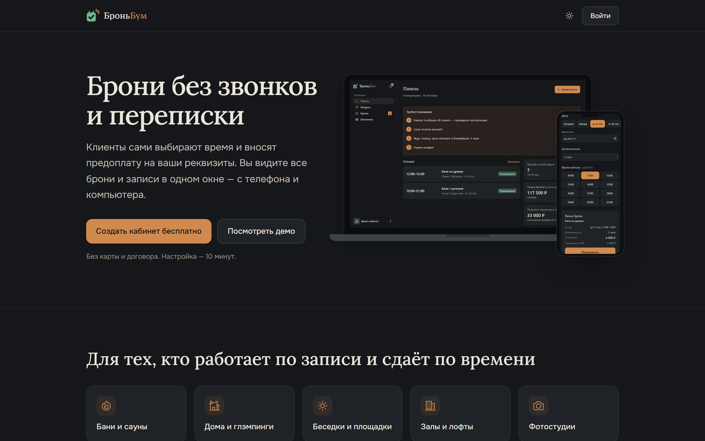
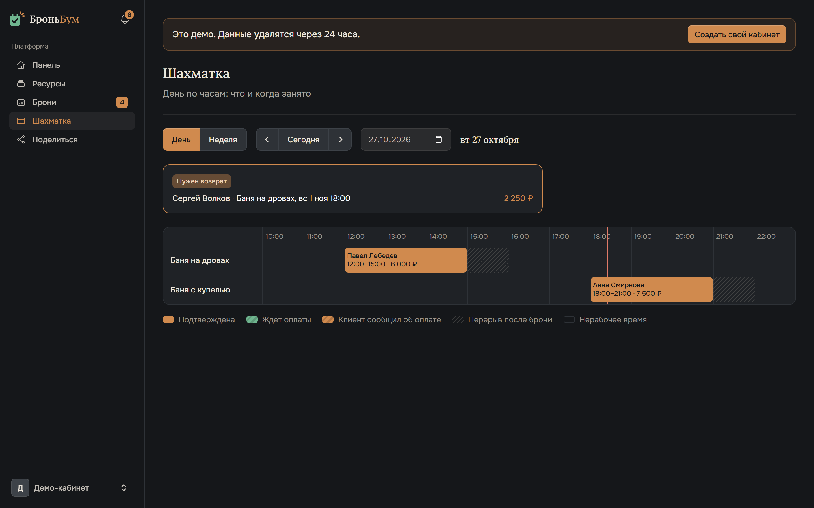
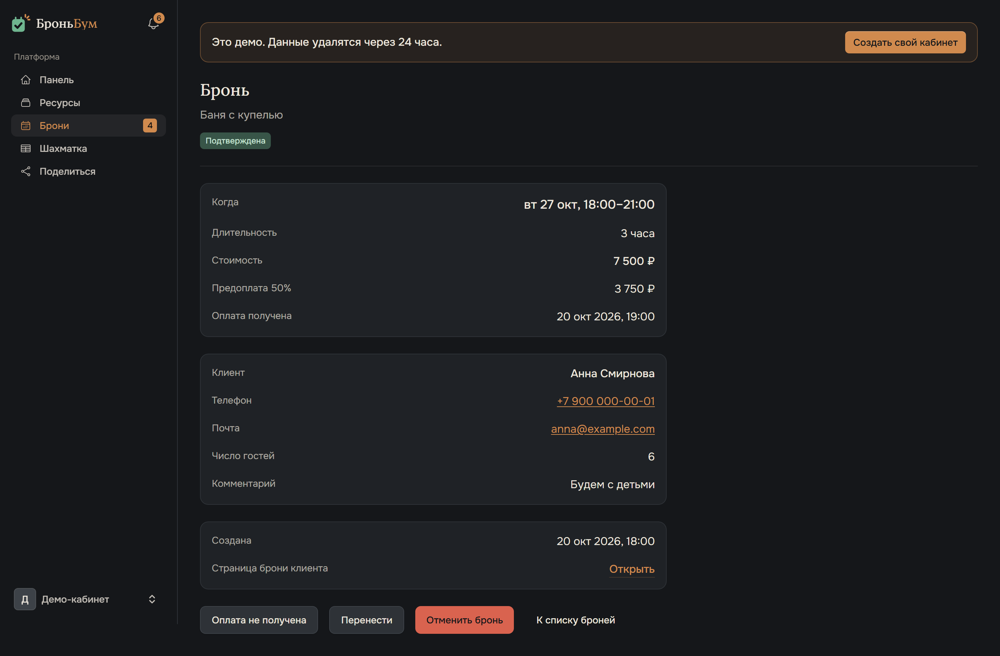
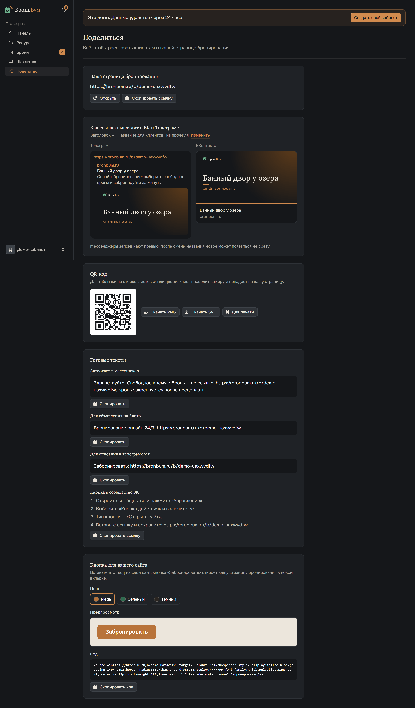
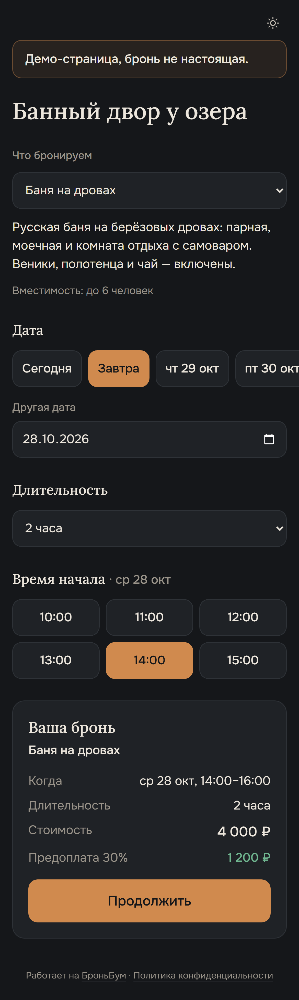
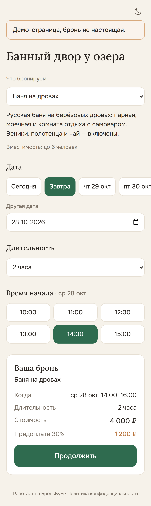
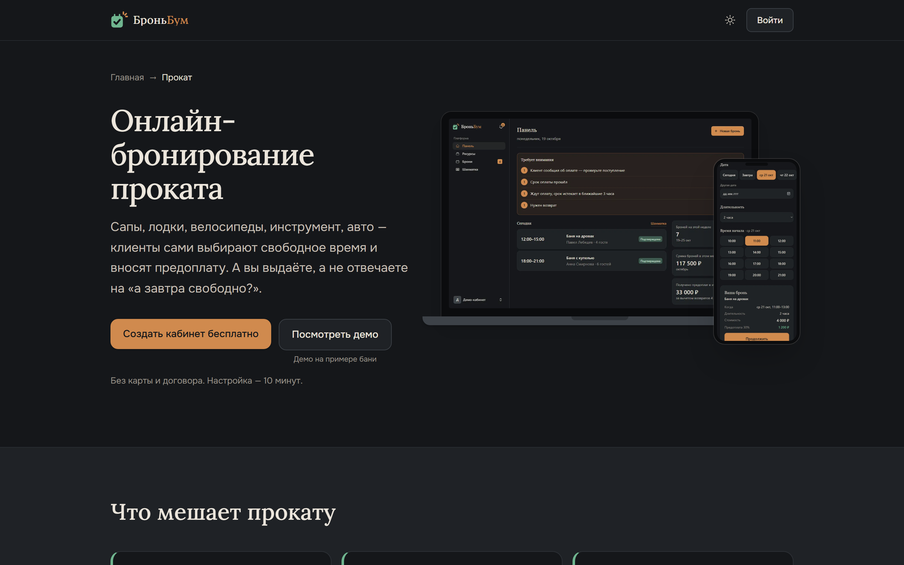
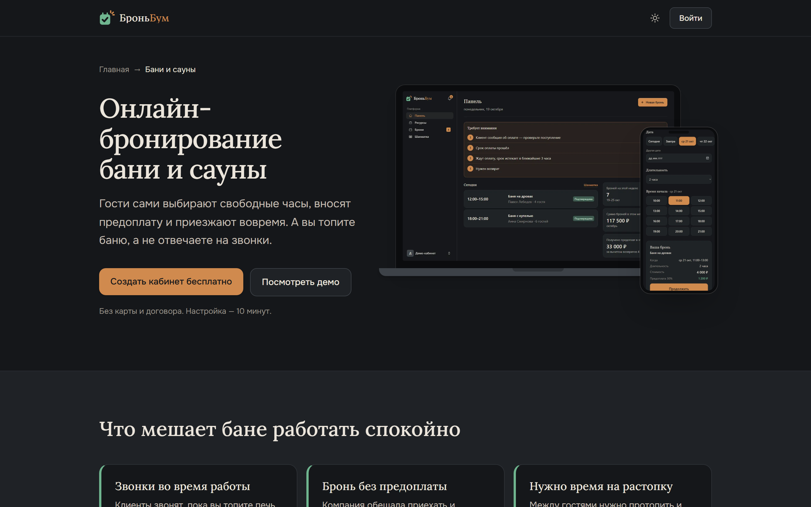

# БроньБум

Сервис онлайн-бронирования для тех, кто сдаёт что-то по времени — баню, дом, зал, корт или запись к мастеру: клиент сам выбирает время и вносит предоплату 24/7, владелец получает письмо и видит бронь в шахматке.

**[Сайт — bronbum.ru](https://bronbum.ru)** · **Демо** — кнопка «Посмотреть демо» на [главной](https://bronbum.ru): личный демо-кабинет создаётся за один клик, без регистрации, и живёт сутки.

Есть и светлая тема — [скриншот](screenshots/02-landing-light.png).

## Что умеет

- **Страница бронирования для клиента.** Клиент с телефона выбирает ресурс, дату, длительность и время начала и сразу видит цену и предоплату. Для домов вместо часов — календарь заезда.
- **Шахматка.** День по часам или неделя по дням, все ресурсы владельца вместе: брони, перерывы после них, нерабочее время, линия «сейчас».
- **Гибкие цены и правила.** Цены по дням недели и часам, минимальная длительность, перерыв между бронями, минимальный срок до начала брони и предел записи вперёд.
- **Предоплата на реквизиты владельца.** Процент от стоимости и срок на оплату. Клиент нажимает «Я оплатил», владелец подтверждает. Если срок вышел, бронь отменяется автоматически или владельцу приходит напоминание — как он выберет.
- **Отмена и перенос.** Бесплатная отмена до заданного срока, частичный возврат при поздней отмене, перенос брони на другое время или другой ресурс, ручные брони из кабинета.
- **Уведомления.** Письма клиенту (бронь, оплата, перенос, отмена, возврат, напоминание за 2 или 24 часа) и владельцу, плюс колокольчик событий в кабинете.
- **«Поделиться».** Ссылка на страницу, превью для ВК и Телеграма, QR-код (PNG, SVG, лист для печати), готовые тексты для Авито и мессенджеров, кнопка «Забронировать» для своего сайта.
- **Страницы под ниши.** 11 посадочных страниц (бани, дома, залы, корты, мастера, прокат и другие) и 32 типа ресурсов.

## Скриншоты

**Шахматка** — день по часам. Штриховка — перерыв на уборку после брони, красная линия — текущее время, сверху — бронь, по которой нужно вернуть предоплату.

**Карточка брони** — время, стоимость, предоплата, данные клиента и действия: снять отметку оплаты, перенести, отменить.

**«Поделиться»** — всё, чтобы рассказать клиентам о странице: ссылка, превью в мессенджерах, QR-код, готовые тексты, кнопка для сайта.

**Клиент с телефона** — выбор даты, длительности и времени; итог и предоплата видны сразу. Тёмная и светлая тема.

  
  

**Страницы под ниши** — прокат и бани.

## Технологии

- **Бэкенд:** PHP 8.3, Laravel 12, MySQL, очереди и планировщик Laravel.
- **Интерфейс:** Livewire 4 + Volt, Flux UI, Tailwind CSS 4, Vite. Шрифты Lora и Onest лежат в проекте — без внешних CDN.
- **Библиотеки:** bacon/bacon-qr-code для QR-кодов, GD для картинок превью. Других сторонних пакетов сверх стартового набора Laravel нет, кроме шрифтов.
- **Инфраструктура:** VPS на Ubuntu 24.04, nginx + PHP-FPM, HTTPS от Let's Encrypt, своя почта на Postfix + OpenDKIM (SPF, DKIM и DMARC проходят — PASS), supervisor для воркеров очереди, ночные бэкапы, деплой одной командой.

## Интересные инженерные решения

1. **Время в UTC, показ в поясе владельца.** Приложение и соединение с MySQL работают в UTC, брони сохраняются в UTC. Показываются в часовом поясе владельца — это одна из 11 зон России из enum, а не свободный текст.
2. **Защита от двойных броней.** Свободно ли время, проверяется заново внутри транзакции с блокировкой строки ресурса (`lockForUpdate`): из двух одновременных броней на одно время пройдёт одна. Оплата, отмена и перенос тоже меняют бронь только под блокировкой, а события и письма уходят после коммита.
3. **Предоплата без эквайринга.** Деньги идут напрямую владельцу, сервис их не принимает. Онлайн-бронь ждёт оплату до срока (от 30 минут до суток, но не позже начала брони), планировщик раз в минуту отменяет просроченные или напоминает владельцу. Если клиент нажал «Я оплатил», автоотмены уже не будет.
4. **Демо-кабинеты с автоочисткой.** На каждого посетителя создаётся свой кабинет с бронями на две недели назад и вперёд от текущего момента. Клиенты вымышленные, письма из демо не уходят, создать можно не больше пяти кабинетов в час с одного IP. Через сутки кабинет удаляется со всеми данными — тем же кодом, что удаляет обычный аккаунт.
5. **Превью ссылок и QR на сервере.** Картинка для ВК и Телеграма (1200×630) рисуется через GD шрифтами проекта. В имени файла — отпечаток названия: сменили название — изменился адрес, и мессенджеры не покажут старую картинку из кеша. QR-код — PNG и SVG с уровнем коррекции M, чтобы читался и с мятой распечатки.
6. **Юридические документы с версиями.** Тексты лежат в Markdown, у редакции есть версия. Вместе с согласием сохраняются время и редакция: у владельца — при регистрации, у клиента — при каждой онлайн-брони. Вышла новая редакция — владелец не попадёт в кабинет, пока не примет её заново (две отдельные галочки, не отмеченные заранее).
7. **Админка без персональных данных клиентов.** Владелец платформы видит статистику и список владельцев, но клиентов только считает: имена и телефоны админка не читает. Демо-кабинеты в статистику не попадают.

Ещё по мелочи: деньги хранятся целыми числами в копейках, статусы, типы и причины — PHP enum.

## Качество

**1353 автотеста, 12 293 проверки** (PHPUnit), все проходят; полный прогон — `php artisan test`. Тесты покрывают бизнес-логику (пересечения броней, цены, оплату, отмены, часовые пояса), страницы Livewire, письма и права доступа.

Разработка велась с ИИ-ассистентом в роли исполнителя: архитектура и продуктовые решения, постановка задач, ревью каждого изменения и приёмка по тестам — мои. Сервер, почту и деплой настраивал сам.

## Соответствие 152-ФЗ

- Персональные данные клиентов хранятся только на сервере в России; внешней аналитики и CDN нет, почта своя.
- Согласие на обработку данных — отдельной галочкой у владельца и у клиента, с сохранением времени и редакции документа.
- Политика конфиденциальности, пользовательское соглашение и текст согласия опубликованы на сайте.
- Уведомление об обработке персональных данных в Роскомнадзор подано.

---

**Код закрыт — покажу на собеседовании.**

Автор — **Максим Измайлов**, PHP/Laravel-разработчик. Связаться: [bronbum.ru/contacts](https://bronbum.ru/contacts).
